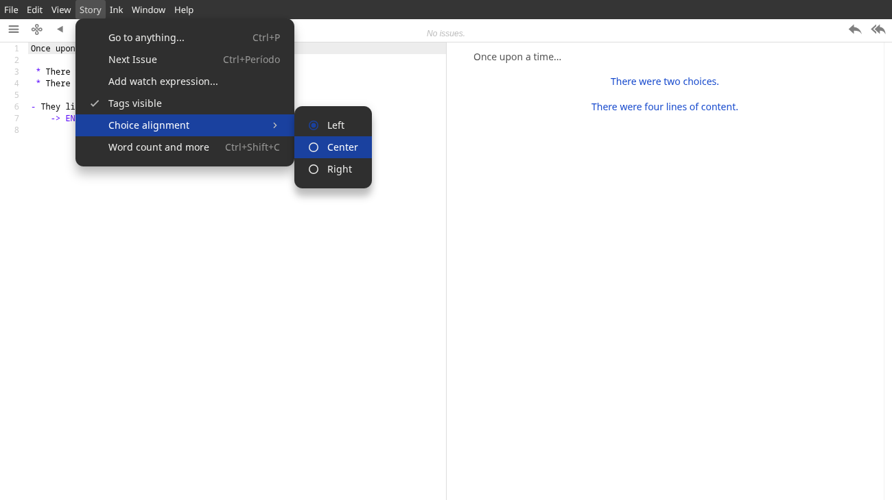
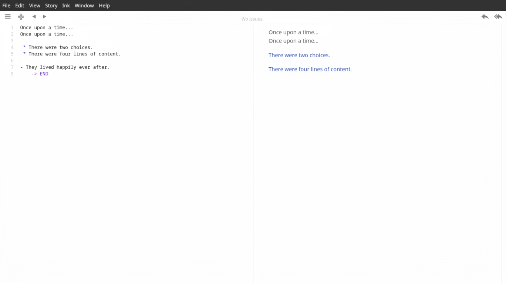
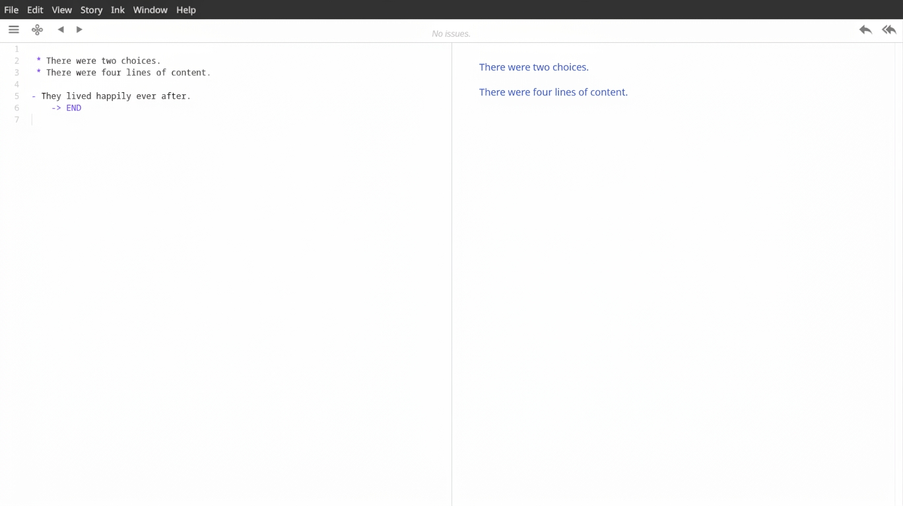

<div align="center">


# Inky · Fork da comunidade

**Escreva, teste e publique histórias interativas com [ink](https://github.com/inkle/ink) em um só lugar.**

Este fork amplia o [Inky original](https://github.com/inkle/inky) com ferramentas para organizar projetos, personalizar a apresentação das histórias e exportá-las para a web.

[](https://github.com/inkle/inky)




</div>

> **Projeto independente:** este fork não é afiliado, endossado ou mantido oficialmente pela inkle Ltd. Inky e ink continuam sendo creditados aos seus criadores originais.

---

## Sobre o projeto

O **Inky** é um editor para **ink**, a linguagem de criação de narrativas interativas usada em jogos como *80 Days*. O editor combina escrita, compilação em tempo real e pré-visualização jogável.

Este fork parte da versão **0.15.2** e concentra melhorias na experiência de autoria: organização de arquivos, ajustes visuais, áudio, imagens e maior consistência entre a prévia do editor e a versão exportada para a web.

## Recursos em destaque

- **Escrita com prévia ao vivo:** veja a história e teste escolhas enquanto edita.
- **Compilação contínua:** erros, avisos e TODOs aparecem no editor; navegue até o trecho correspondente.
- **Projetos com vários arquivos:** organize cenas e pastas; o Inky acompanha linhas `INCLUDE`.
- **Explorer de projeto:** crie, importe, renomeie e remova arquivos e pastas.
- **Configurações visuais:** ajuste título, autoria, tipografia, cores, layout e alinhamento pela interface.
- **Tags de mídia:** use imagens e áudio na história, com prévia de arquivos no projeto.
- **Exportação para web:** publique uma versão jogável com controles, estilo e recursos da história.
- **Temas do editor:** alterne entre temas claros e escuros.

## O que este fork acrescenta

| Recurso | Comportamento |
|---|---|
| Linhas e parágrafos | Linhas consecutivas ficam compactas; uma linha vazia cria uma quebra visual. |
| Escolhas | Cor azul, com alinhamento à esquerda, ao centro ou à direita. |
| `#clean` | Limpa o texto anterior ao entrar em uma cena ou escolha marcada. |
| Alinhamento por cena | `#align:` pode ajustar uma cena sem mudar o alinhamento geral da história. |
| Títulos | Configure título da história, autoria e títulos de cena. |
| Áudio | `#music:` controla música; `#sound:` reproduz efeitos sonoros. |
| Imagens | `#image:` inclui imagens locais ou remotas na história. |
| Exportação | A apresentação e as configurações visuais acompanham a história exportada. |

### Exemplo de tags

```ink
=== chegada ===
#title: A estação
#align: center
#image: station.jpg

O último trem parte à meia-noite.
#sound: train.mp3

* Esperar pelo próximo trem.
    -> noite #clean

* Voltar para casa.
    -> casa
```

Para música de fundo, use `#music: arquivo.mp3`. Para encerrar a música, use `#music: stop`; para interromper efeitos sonoros, use `#sound: stop`.

> **Compatibilidade:** as melhorias visuais deste fork têm como foco o Inky e seu player exportado para a web. Por exemplo, a quebra visual criada por uma linha vazia é representada como `<br>` no conteúdo compilado; outros runtimes podem exibir essa marcação literalmente se não tiverem suporte específico.

## Capturas de tela

**Alinhamento das escolhas**


**Quebras de linha**



**Escolhas azuis**



## Instalação para desenvolvimento

### Requisitos

- [Node.js](https://nodejs.org/) e npm
- Git

### Executar o Inky

```bash
git clone https://github.com/ytriosa/inky.git
cd inky/app
npm install
npm start
```

### Executar os testes

```bash
cd inky/app
npm test
```

### Gerar pacotes

Na pasta `app/`, o script aceita os destinos `linux`, `mac`, `win32` (32 bits) e `win64` (64 bits). Exemplo a partir da raiz do repositório:

```bash
cd app
npm run build-package -- linux
```

Para criar um arquivo de distribuição compactado, acrescente `-zip`:

```bash
cd app
npm run build-package -- linux -zip
```

Compilações para macOS precisam ser executadas em um Mac. No Linux, o script de distribuição gera o bundle do aplicativo, o AppImage e o pacote Debian:

```bash
cd inky
npm install --global electron-packager
./BUILD_FOR_LINUX.sh
```

O pacote Debian é destinado a Linux x86_64. Consulte os scripts de compilação para os pré-requisitos específicos de cada plataforma.

## Downloads

Pacotes publicados, quando disponíveis, estarão na página de [Releases](https://github.com/ytriosa/inky/releases).

## Desenvolvimento e contribuições

Sugestões, problemas e contribuições são bem-vindos. Abra uma [issue](https://github.com/ytriosa/inky/issues) descrevendo o comportamento observado e, se possível, os passos para reproduzi-lo.

Este fork é desenvolvido com orientação humana e assistência de ferramentas de IA. As mudanças são implementadas, testadas e revisadas no projeto.

## Créditos e licença

- **Inky e ink:** criados pela [inkle Ltd](https://github.com/inkle). O projeto original é distribuído sob a licença MIT.
- **Este fork:** as alterações estão identificadas no arquivo [`LICENSE`](LICENSE), junto aos créditos do projeto original.
- **Dependências:** Electron, Chromium, inkjs e demais dependências têm licenças próprias; consulte os avisos incluídos na distribuição.

*Inky recebeu esse nome em homenagem a um gato preto de Cambridge, no Reino Unido.*
