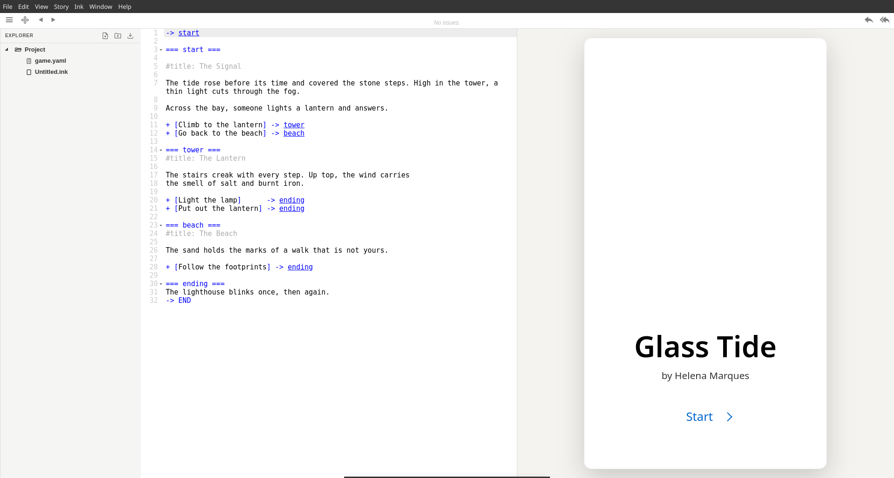
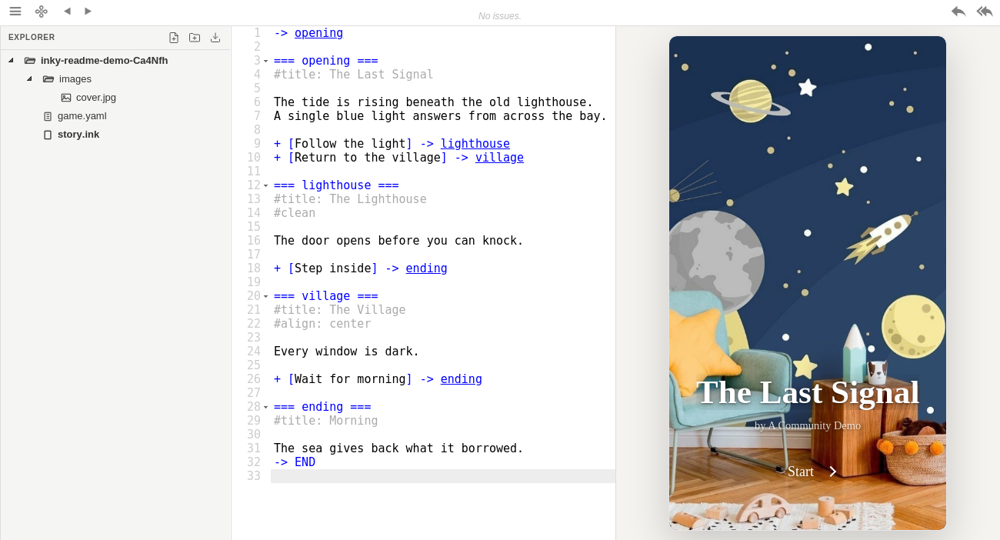
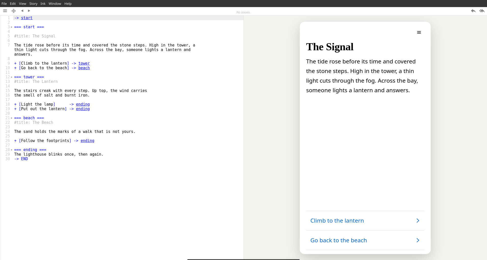

<div align="center">


# Inky enhanced community fork

**Create and play ink-powered games without leaving your IDE [ink](https://github.com/inkle/ink).**

A feature-rich continuation of [inkle's Inky](https://github.com/inkle/inky), with a project Explorer, visual game settings, media support, and a web player.

[](https://github.com/inkle/inky)




</div>

> **Independent community fork.** This project is not affiliated with, endorsed by, or officially maintained by inkle Ltd. Inky and ink remain credited to their original creators.

---

## What is Inky?

Inky is a desktop editor for **ink**, inkle's scripting language for interactive narrative. Write a story in plain-text `.ink` files, compile as you work, and play through choices in the built-in preview.

This fork builds on Inky **0.15.2** with expanded authoring tools and a web export designed to carry your story's presentation and media with it.

## Features

### Write and test in one place

- Syntax highlighting, ink snippets, tag autocomplete, and jump-to-definition.
- Live compilation with errors, warnings, and TODOs linked to their source locations.
- A playable preview that keeps your place as the story recompiles.
- Bold and italic formatting for narrative text with **Ctrl/Cmd+B** and **Ctrl/Cmd+I**.
- Light, dark, focus, and contrast editor themes.

### Organize complete story projects

- A project Explorer for scenes, folders, style files, images, and audio.
- Create and import project files, rename or delete them, and select multiple items for batch actions.
- Include-aware projects: Inky follows `INCLUDE` statements and helps create included scenes.
- A file watcher that reflects changes made outside Inky.
- Preview image and audio files directly from the Explorer.

### Shape the reader experience

Use the **Visual** settings panel to configure the story without hand-editing YAML. Changes update the preview and are stored in the project's `game.yaml`; the **Advanced** tab remains available for direct YAML editing.

- Preset looks, light/dark palettes, custom colors, fonts, font size, line height, and text width.
- Story text and choice alignment can be set independently.
- Reading layouts: automatic, portrait (9:16), landscape (16:9), square (1:1), or a custom aspect ratio.
- Story title, author, cover art, and a dedicated title screen with a **Start** button.
- Scene-title typography and alignment, with per-scene alignment overrides.
- Optional reader controls, including a light/dark appearance toggle.

### Add sound and images

Use ink tags to add media to passages:

```ink
=== station ===

#title: The Station
#image: station.jpg
#sound: train.mp3

The last train pulls in.
Its brakes shriek in the night.
```

**Sound tags**

- `#music: filename.mp3` starts or changes looping music.
- `#music: stop` stops the music.
- `#sound: filename.mp3` plays a sound effect once.
- `#sound: stop` stops active sound effects.

Audio files can be organized in `audio/` (including `music/`, `musics/`, and `sfx/` subfolders). Supported formats include MP3, OGG, WAV, M4A, AAC, FLAC, Opus, and WebM. The Visual settings provide separate master, music, and sound-effect levels.

Use `#image: filename.png` to show a picture in the story. Local pictures are collected into the web export; remote HTTP(S) images remain remote. Import images into the project or use the Explorer to inspect them. A project favicon can also be included in the exported page.

## What this fork changes

| Area | Inky 0.15.2 | This fork |
|---|---|---|
| Story line breaks | Standard paragraph spacing | Consecutive lines can stay compact; a blank line creates a visible break. |
| Choices | Original choice styling | Blue choices with independent left, center, or right alignment. |
| Story alignment | Story-wide alignment | `#align:` can override alignment for a scene or paragraph. |
| Authoring settings | Edit presentation in project files | Configure appearance through Visual settings or edit `game.yaml` directly. |
| Media | Basic story editing | Preview and manage audio and images; export referenced story assets. |
| Publishing | Standard web export | Export a styled, playable web version with the title screen and reader controls. |

### Alignment tags

`#align: left`, `#align: center`, or `#align: right` changes text alignment. On a scene's opening line alongside `#title:`, it applies to that scene; on another paragraph, it applies only to that paragraph.

### Web export

**File → Export for web** creates a complete player folder with the compiled story, the inkjs runtime, styles, and the assets referenced by the story, including audio, local images, cover art, and favicon when present. Remote images remain online references. The exported player includes a title screen, reader controls, and save/load support.

## Screenshots

**Title screen**



**Live story preview**



## Compatibility notes

The main target is the Inky editor and its web export. Some presentation features are specific to this fork. In particular, blank-line formatting is represented as literal `<br>` text in compiled story content; other game runtimes may show `<br>` literally unless they handle it.

## Get started

### Requirements

- [Node.js](https://nodejs.org/) and npm
- Git

### Install and run from source

```bash
git clone https://github.com/ytriosa/inky.git
cd inky/app
npm install
npm start
```

### Run tests

From `inky/app/`:

```bash
npm test
```

To run the web-export smoke tests only:

```bash
npm run test:web-export
```

### Build packages

From `inky/app/`, build for Linux, macOS, Windows 32-bit, or Windows 64-bit:

```bash
npm run build-package -- linux
```

Add `-zip` to produce a distributable archive:

```bash
npm run build-package -- linux -zip
```

macOS builds must run on macOS. The root-level `BUILD_FOR_LINUX.sh` builds the Linux x64 application bundle, AppImage, and Debian package. Consult the build scripts for platform-specific tools and requirements.

## Downloads

Check [GitHub Releases](https://github.com/ytriosa/inky/releases) for downloadable packages when they are published.

## Contributing

Bug reports, suggestions, and contributions are welcome. Please open an [issue](https://github.com/ytriosa/inky/issues) with a description and steps to reproduce the behavior, if applicable.

## Credits and license

- **Inky and ink** are projects by [inkle Ltd](https://github.com/inkle). The original Inky project is distributed under the MIT License.
- This fork's changes and the applicable copyright notices are documented in [`LICENSE`](LICENSE).
- Electron, Chromium, inkjs, and other dependencies are distributed under their respective licenses; see the included third-party notices.

*Inky is named after a black cat based in Cambridge, UK.*
