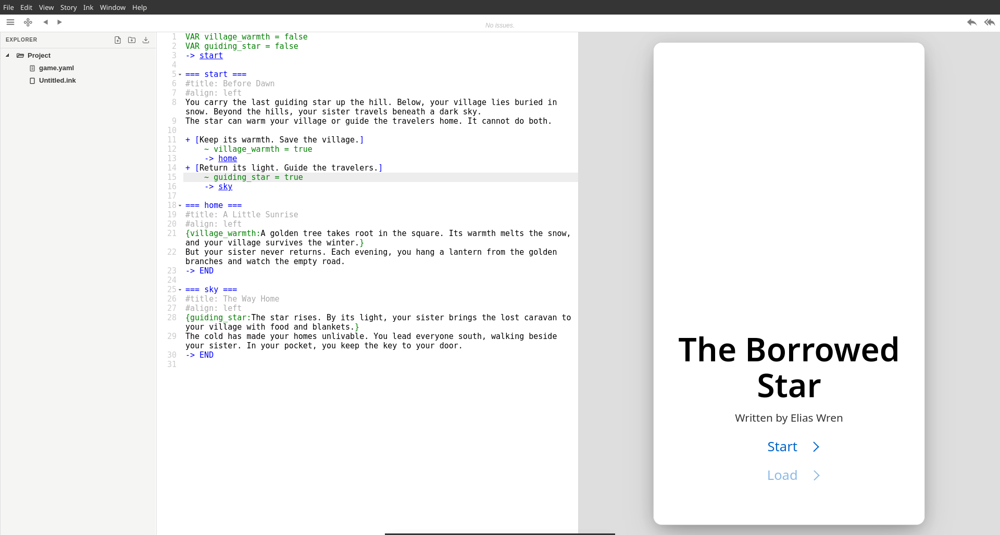
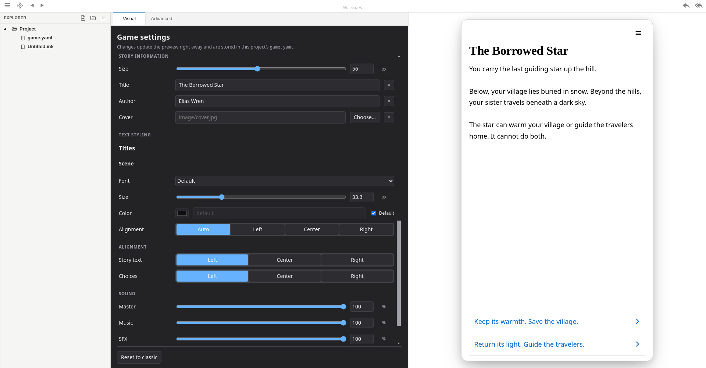
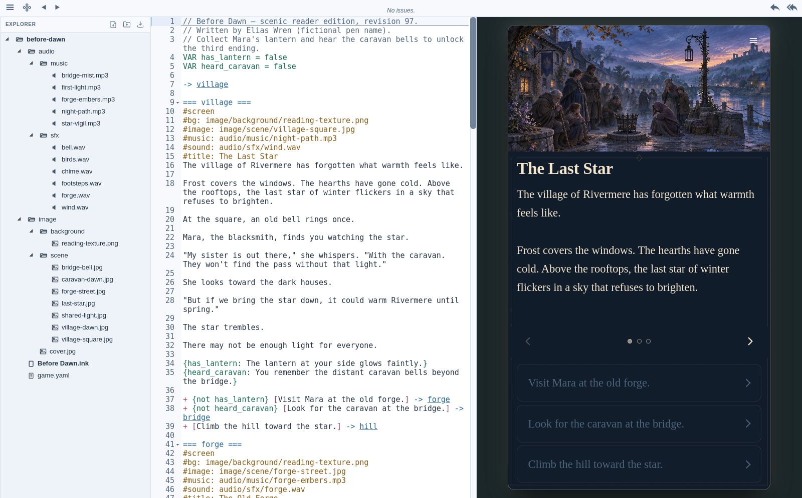
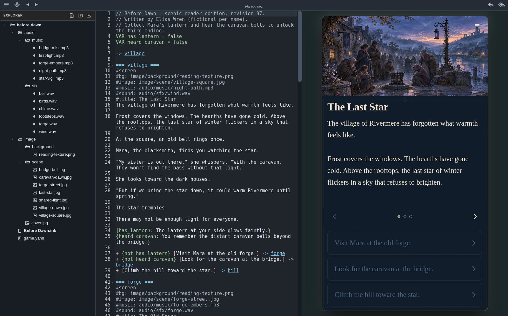
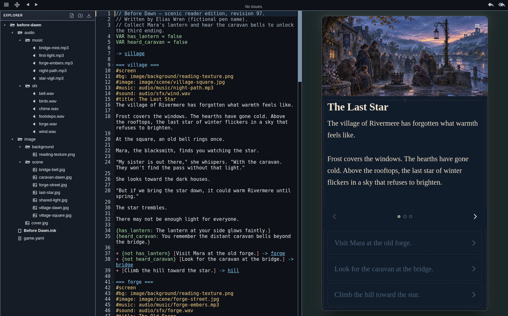
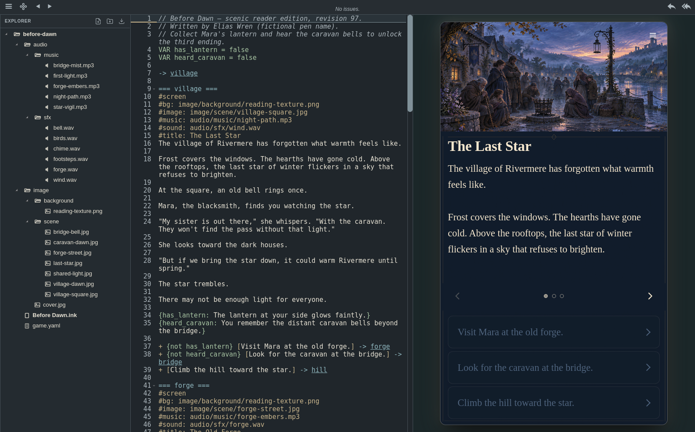
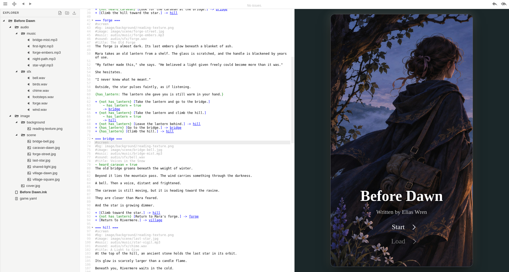
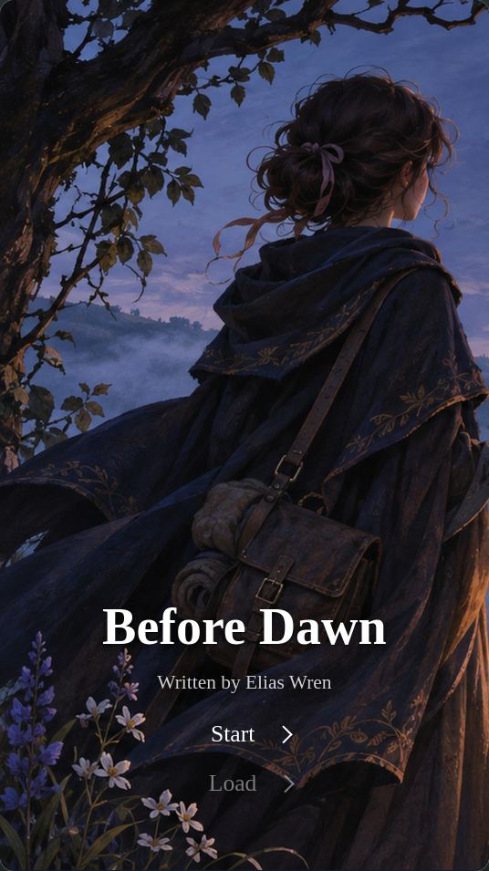
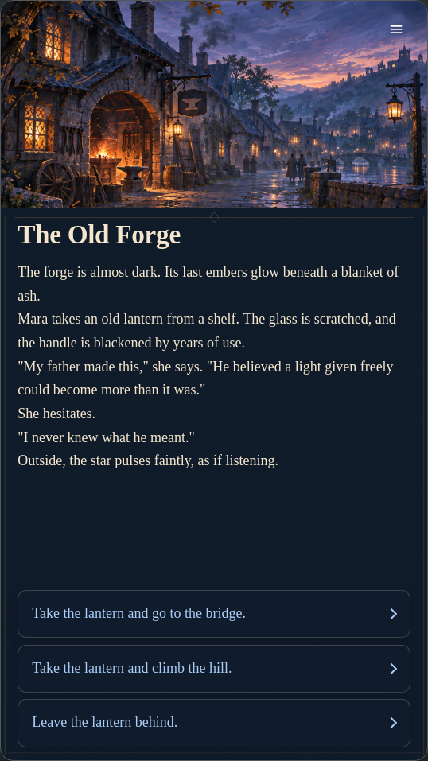
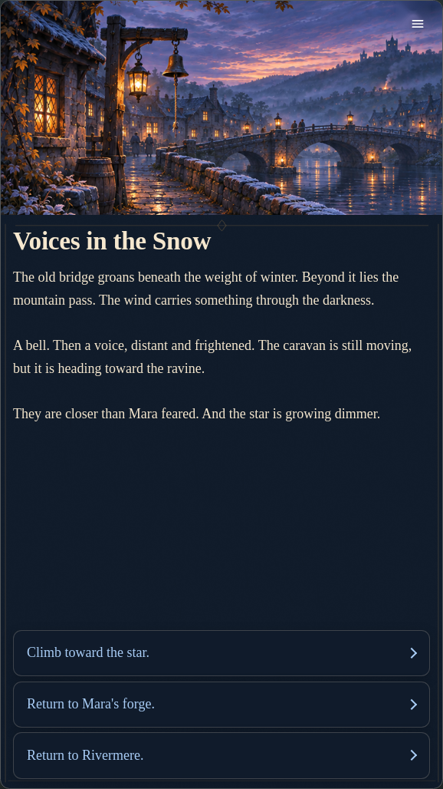

<div align="center">


<h1>Inky</h1>

<p><strong>Write with ink. Bring your stories to life.</strong></p>

<p><strong>Inky Extended</strong> is an independent, community-maintained fork of <a href="https://github.com/inkle/inky">inkle's Inky</a>. It builds on the desktop editor for <a href="https://github.com/inkle/ink">ink</a> with customizable story presentation, a live player, multimedia scenes, and web export.</p>

<p>
  <a href="https://github.com/inkle/inky"></a>
  
  <a href="LICENSE"></a>
</p>

<a href="docs/screenshots/default-first-open.png">
  
</a>

<p><em>The first-open experience: <strong>The Borrowed Star</strong>, ready to read, explore, and edit.</em></p>

</div>

> **An independent fork.** Inky and the ink language were created by [inkle](https://www.inklestudios.com/ink/). Inky Extended builds on their work and is not affiliated with or endorsed by inkle Ltd. Ink syntax, variables, choices, and branching logic remain at its core.

## Write a story. See it come alive.

Write Ink on the left. Experience the story on the right. As you revise passages, introduce choices, or adjust the presentation, the live Preview lets you see how your story reads and plays.

<a href="docs/screenshots/live-preview-basic-passage.png">
  
</a>

*A passage with a title, narrative text, and choices, shown alongside the Visual settings that shape its appearance.*

Opening Inky without selecting a file reopens your most recent available saved project. The starter story appears when no saved project is available; use **File → New** to start a fresh story.

The familiar Inky writing tools are still here: syntax highlighting, autocomplete, reusable snippets, issue reporting, the project Explorer, and interactive story navigation. Inky Extended adds more ways to shape what readers see and hear.

## Choose your writing environment

Use **View → Theme** to choose the editor's appearance. The four IDE themes are
independent of the story's `game.yaml` palette: changing the editor theme keeps
the Preview, story audio, and exported game presentation intact.

| Menu entry | Writing environment |
| :-- | :-- |
| **Light — Pearl** | White writing paper, soft surrounding panels, and clear Ink accents |
| **Dark — Graphite** | A balanced dark workspace for everyday writing |
| **Contrast — Contrast 2.0** | Near-black surfaces and strong, readable indicators |
| **Focus — Quiet Writing** | Warm text on slate with understated navigation cues |

<div align="center">

<a href="docs/screenshots/theme-pearl.png"></a>
<a href="docs/screenshots/theme-graphite.png"></a>

<p><em>Light — Pearl</em> · <em>Dark — Graphite</em></p>

<a href="docs/screenshots/theme-contrast.png"></a>
<a href="docs/screenshots/theme-focus.png"></a>

<p><em>Contrast 2.0</em> · <em>Focus — Quiet Writing</em></p>

</div>

These are real Electron captures at the same window size. Click an image to
inspect it at full resolution. Long passages use the reader's page controls;
choices become available after the final page.

## Shape the reader's experience

Use the **Visual** tab to customize presentation without writing CSS. Project settings live in `game.yaml`, while the **Advanced** tab provides direct access to the underlying configuration.

| Presentation | What you can customize |
| :-- | :-- |
| **Classic, Night, Sepia, and Terminal** themes | Distinct visual styles, with optional light/dark switching |
| **Typography and layout** | Fonts, sizes, spacing, and alignment in a readable **9:16 portrait layout** |
| **Title Screen** | Cover image, story title, author credit, and title size in pixels |
| **Sound controls** | Separate master, music, and sound-effects volume |
| **Story endings** | Optional **The End** marker and **Play Again** button |

The Title Screen is distinct from the story's passages: a scene background does not replace the cover. Keep your story text-focused, or give each scene its own illustrated atmosphere.

### Traditional and Screen modes

**Traditional Mode** supports a continuous reading experience. **Screen Mode** presents passages as separate, self-contained screens while preserving Ink's choices, variables, and diverts.

Screen Mode is optional. Select it under **Visual → Story presentation**, then mark a screen with `#screen`:

```ink
=== bridge ===
#screen
#title: Voices in the Snow

The old bridge groans beneath the weight of winter.

+ [Climb toward the star.] -> hill
```

### Images, backgrounds, music, and sound

Scene tags give passages individual artwork and atmosphere:

```ink
=== bridge ===
#screen
#bg: image/background/reading-texture.png
#image: image/scene/bridge-bell.jpg
#music: audio/music/bridge-mist.mp3
#sound: audio/sfx/bell.wav
#title: Voices in the Snow

The old bridge groans beneath the weight of winter.

+ [Climb toward the star.] -> hill
```

`#image` places an illustration above the passage; `#bg` displays an image behind the scene. `#title` adds a passage heading, while `#music` and `#sound` control audio. Folder names are conventions, not requirements: you can reference assets using project-relative paths. The filenames above are illustrative; use files from your own story project.

## Meet Before Dawn

**Before Dawn** is the included showcase: a short fantasy adventure that brings together Ink writing, illustrated scenes, audio, branching choices, and three endings.

Unlike a static demo, it is a **real, editable story project**. Open it through **Ink → Full stories** to examine its writing, scene assets, project settings, and alternate outcomes.

<a href="docs/screenshots/showcase-editor-before-dawn.png">
  
</a>

*A single Before Dawn project in the Explorer, with its Ink source, original assets, and live Title Screen in the Preview.*

### Start with a cover

<div align="center">

<a href="docs/screenshots/showcase-title-screen.png">
  
</a>

<p><em>The actual Title Screen in the Inky Preview: cover, title, author credit, Start, and Load.</em></p>

</div>

### Give every passage its own atmosphere

Combine **top artwork**, **background textures**, **scene titles**, **narrative text**, and **choices**. Each passage can have its own presentation while retaining a consistent reading frame.

<div align="center">

<a href="docs/screenshots/showcase-scene-old-forge.png"></a>
<a href="docs/screenshots/showcase-scene-voices-in-the-snow.png"></a>

<p><em>The Old Forge</em> · <em>Voices in the Snow</em> — two actual passages captured from <strong>Before Dawn</strong> in the Inky Preview.</p>

</div>

Music and sound effects add atmosphere alongside the illustrations and narrative. The showcase includes these assets and multiple outcomes so you can explore how the pieces work together.

Browse the [story source](app/resources/showcase/before-dawn/Before%20Dawn.ink) and [project settings](app/resources/showcase/before-dawn/game.yaml). **Elias Wren** is the fictional author credited within the showcase.

## Built on the original Inky

The original Inky examples remain available as independent, editable projects:

- **Crime Scene** — from *Writing with Ink*
- **Swindlestones** — from *Sorcery!*
- **Pontoon Game** — from *Overboard!*
- **The Intercept**

In **Ink → Full stories**, these appear together above a divider, with **Before Dawn** presented separately beneath it. The examples retain their original credits, with compatibility adjustments where needed for this edition's reader.

**The Borrowed Star** is the first-open starter project. It is separate from both the original sample collection and the illustrated showcase.

## Take your story to the web

Choose **File → Export for web** to create a browser-playable version of your story, including its reader interface, styling, and referenced local assets. Web Export supports the Title Screen, scene media, choices, endings, and Save/Load.

Preview and Web Export are designed to behave consistently. Before sharing a story, test the exported `index.html` and its assets in a browser.

## Download and run

**Inky Extended 0.15.2-117** is available for **Linux x86-64**. All four files are available in the [v0.15.2-117 release](https://github.com/glassflare/inky/releases/tag/v0.15.2-117).

| Download | File |
| :-- | :-- |
| **Debian / Ubuntu (amd64)** | [Inky-Extended-0.15.2-117-amd64.deb](https://github.com/glassflare/inky/releases/download/v0.15.2-117/Inky-Extended-0.15.2-117-amd64.deb) |
| **AppImage (x86_64)** | [Inky-Extended-0.15.2-117-x86_64.AppImage](https://github.com/glassflare/inky/releases/download/v0.15.2-117/Inky-Extended-0.15.2-117-x86_64.AppImage) |
| **Source archive** | [Inky-Extended-0.15.2-117-source.zip](https://github.com/glassflare/inky/releases/download/v0.15.2-117/Inky-Extended-0.15.2-117-source.zip) |
| **SHA-256 checksums** | [SHA256SUMS.txt](https://github.com/glassflare/inky/releases/download/v0.15.2-117/SHA256SUMS.txt) |

### Debian / Ubuntu

Download the `.deb`, then install it from the directory where you saved it:

```bash
sudo apt install ./Inky-Extended-0.15.2-117-amd64.deb
```

When replacing an experimental build with a higher Debian revision, such as
`0.15.2-11092`, add `--allow-downgrades` to that command. Stable r110 through r116 installations
upgrade normally to r117. Confirm an intentional downgrade before using that option.

### AppImage

Download the AppImage, make it executable, and run it:

```bash
chmod +x Inky-Extended-0.15.2-117-x86_64.AppImage
./Inky-Extended-0.15.2-117-x86_64.AppImage
```

Some Linux distributions may require FUSE compatibility libraries to run AppImages. The repository also contains build scripts for other platforms; the prebuilt downloads listed above target Linux.

### Verify your downloads

Place the downloaded files and `SHA256SUMS.txt` in the same directory, then run:

```bash
sha256sum -c SHA256SUMS.txt
```

The command checks all three packages listed in the checksum file. Download all three packages if you want every entry to report `OK`; otherwise, checksum verification for missing files will report an error.

### Build from source

You will need Node.js, npm, Git, and the system libraries required by Electron.

```bash
git clone https://github.com/glassflare/inky.git
cd inky/app
npm ci
npm start
```

To run the test suites from `app/`:

```bash
npm test
npm run test:web-export
```

The default suite retains 14 existing optional GPU, legacy WebDriver, and media-picker cases as pending; they are not counted as passed. The release notes record validation of the real Linux packages.

The permanent [Legendary 25 A's regression](app/test/legendary-25-as-regression.test.js)
also checks real displayed pixels, title/blank-line edits, window sizes and scrolling.
On Linux with an X11 display and GPU acceleration, enable it for a packaged build:

```bash
INKY_RUN_VISUAL_TESTS=1 INKY_VISUAL_REQUIRED=1 npm test
```

Set `INKY_TEST_APP` to an absolute executable path when testing a package outside
the usual `Inky-linux-x64` directory. Graphical artifacts and isolated profiles can
be retained with `INKY_VISUAL_ARTIFACTS=/absolute/output/directory`.

The packaged Linux build uses the compatible source-map compiler built by the reproducible pipeline described in [compiler/source-map-protocol.md](compiler/source-map-protocol.md). The compiler binaries tracked in Git LFS do not provide that protocol; build the compatible compiler to use accurate Alt+click navigation when running from source.

The underlying app version remains **0.15.2**; **r117** is the community revision. **Inky Extended** identifies this fork's distribution, not a change to Ink syntax or the original Inky project's ownership.

## Contribute

Bug reports, suggestions, and contributions are welcome through [GitHub Issues](https://github.com/glassflare/inky/issues). Include your Linux distribution, build revision, reproduction steps, and whether a problem appears in Preview, Web Export, or both.

## Credits and license

The original [Inky](https://github.com/inkle/inky) editor and [ink](https://github.com/inkle/ink) language were created by **inkle Ltd**. Inky Extended is an independent community fork, not an official inkle release. Original examples retain their historical credits. Distributed under the [MIT License](LICENSE), subject to applicable upstream and third-party notices.
