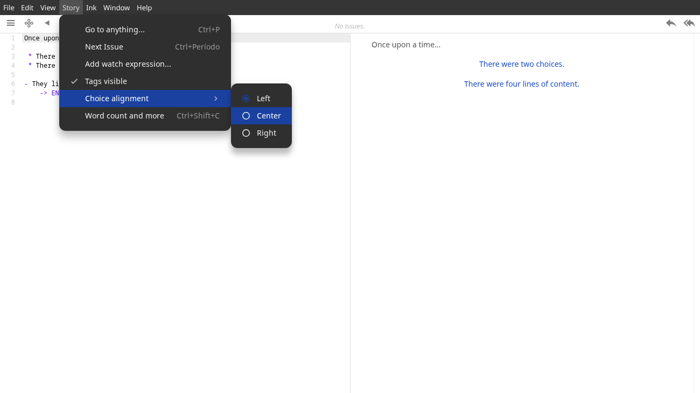
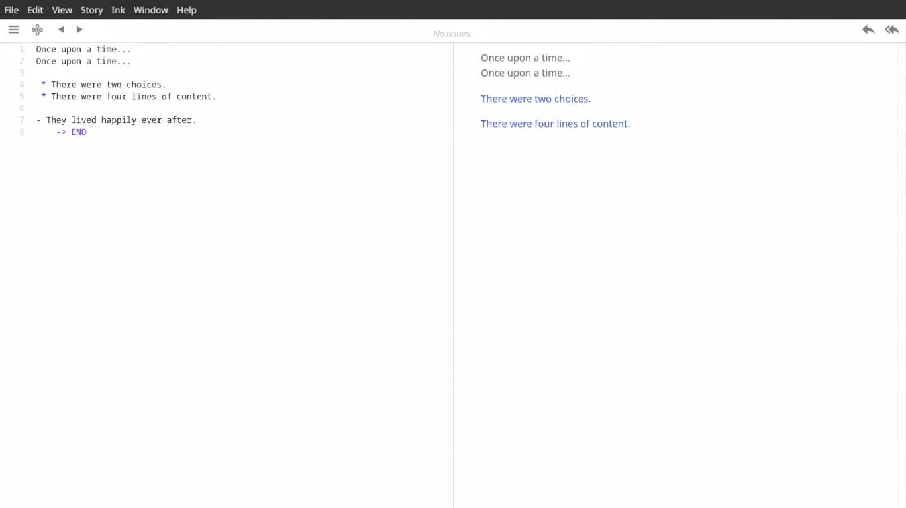
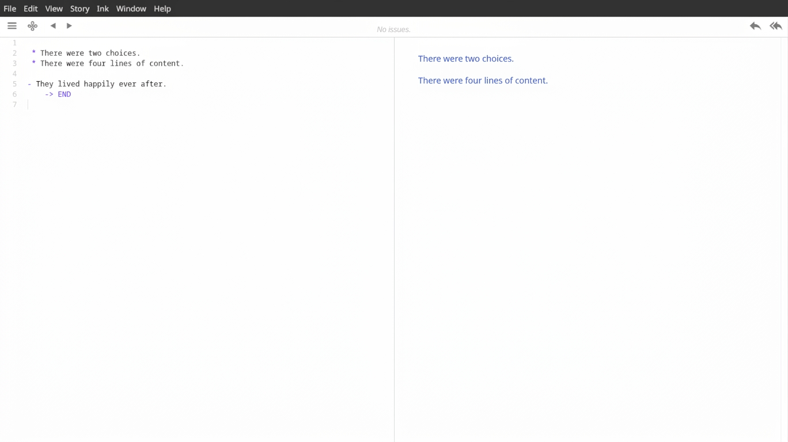

# Inky · fork

**A fork of [Inky](https://github.com/inkle/inky), inkle's editor for [ink](https://github.com/inkle/ink), focused on creating, testing, and publishing complete text games using only the Inky IDE.**

Developed in collaboration with generative AI, under human direction, with implementation, debugging, testing, and validation of custom features.

<div align="center">

[](https://github.com/inkle/inky)




</div>

> **Unofficial fork:** This project is not affiliated with, endorsed by, or officially supported by inkle Ltd. Inky and ink remain credited to their original creators.

---

## Project status

This fork is in its **early stages of development**, with a focus on refining the Inky writing, preview, and web publishing experience.

The core features described in this README have been implemented and tested in the development environment. As the project continues to evolve, further testing, refinements, and compatibility improvements may be introduced.

Feedback, bug reports, and suggestions are welcome and will help guide future improvements.

**Please note:** this fork is independently maintained and is not an official release of inkle's Inky. Users are encouraged to keep backups of their stories and project files, as they would with any software under active development.

---

## Why this fork?

The goal is simple: **write, play, and publish a complete text game using only the Inky IDE**, without requiring Unity or another game engine.

The fork focuses on making the editor's live preview and its web export behave consistently.

- **Write:** create interactive stories using ink's familiar syntax.
- **Play:** test your story in the live preview, with compact line spacing, blue choices, configurable choice alignment, and scene clearing.
- **Publish:** use **Export for web** to generate a playable web version with the same presentation.

The primary target is the Inky IDE and its web export. Using compiled JSON in other engines, such as Unity or custom inkjs players, is not a primary goal. Some custom presentation features may require additional handling in other runtimes.

## What's different from upstream?

Compared with the official [Inky 0.15.2](https://github.com/inkle/inky/releases/tag/0.15.2):

| Feature | Official Inky 0.15.2 | This fork |
|---|---|---|
| **Line breaks** | Empty lines are ignored; paragraphs use default spacing | Consecutive story lines appear tightly together; an empty line between text lines creates a visible line break |
| **Choice color** | Gray (`#BBB`) | Blue (`#0066CC`), like web links; lighter blue (`#66B2FF`) in dark, focus, and contrast themes |
| **`#clean` tag** | Not available | Clears the previous scene's text when the tagged scene or choice is entered |
| **Choice alignment** | Choices are centered | Left, center, or right alignment through **Story → Choice alignment**; defaults to left |
| **Web export** | Standard upstream behavior | Includes the fork's custom presentation features |

---

## Features

### 1. Compact line spacing and line breaks

Story text is displayed with consecutive lines close together, without the extra paragraph spacing found in the original editor.

To insert a visible line break, leave an empty line between two lines of story text. Press **Enter** to move to the next line, and press **Enter** again on an empty line to create the separation.

For example:

**Editor:**

```ink
Once upon a time...
Once upon a time...

* There were two choices.
* There were four lines of content.

- They lived happily ever after.
    -> END
```

**View:**

```text
Once upon a time...
Once upon a time...
There were two choices.
There were four lines of content.
```

The blank line separates the first two lines from the following choices. The choices themselves retain their normal behavior.



**How it works**

- Consecutive story lines stay close together.
- An empty line between two text lines becomes a visible line break.
- Choices, diverts, knots, logic, comments, and glue (`<>`) retain their normal ink behavior.
- Source line numbering remains unchanged, so compiler error locations continue to correspond to the source.

**Compatibility note:** this fork targets the Inky IDE and its web export. Empty lines between text lines are represented in the compiled JSON as literal `<br>` text. The preview and web export render this as a line break. Other runtimes, including Unity or custom inkjs players, may display `<br>` literally unless they explicitly handle it.

### 2. Blue choices

Choices are displayed in blue (`#0066CC`), matching the familiar appearance of web links.

In dark, focus, and contrast themes, a lighter blue (`#66B2FF`) is used to improve readability.

The goal is to make interactive choices visually distinct from narrative text while preserving a clean, link-like appearance.



### 3. Choice alignment

Choose how interactive choices are aligned within the story view.

Open **Story → Choice alignment** and select one of the available options:

- **Left** — aligns choices to the left.
- **Center** — centers choices.
- **Right** — aligns choices to the right.

The default alignment is **left**.


Only choices are affected. Narrative text, titles, and other elements retain their own alignment settings.

The selected alignment is also preserved when using **Export for web**, keeping the published story consistent with the live preview.

### 4. `#clean`: clear the screen between scenes

The `#clean` tag clears the previous scene's text when a new scene begins. The page header and background remain visible.

Place the tag on the first line of the incoming scene:

```ink
=== scene_1 ===
You are in the first scene.

-> scene_2

=== scene_2 ===
#clean
The new scene starts here.
This line continues normally.
```

When `scene_2` begins, the previous scene's text is cleared, and the new scene starts with `The new scene starts here.`

**Behavior**

- Case-insensitive: `#clean` and `#CLEAN` both work.
- The tag is a control instruction and is not displayed as story text.
- A choice tagged with `#clean` also clears the previous transcript when selected.
- Without `#clean`, the usual transcript behavior remains: previous text is retained and a divider is added when applicable.
- Works in the live preview and in exported web stories.

This feature makes it possible to create scene transitions without requiring a separate game engine or custom runtime code.

---

## Build from source

### Requirements

- [Node.js](https://nodejs.org/)
- npm
- Git

### Clone and run

```bash
git clone https://github.com/ytriosa/inky.git
cd inky/app
npm install
npm start
```

### Package the application

From the `app/` directory:

```bash
npm run build-package -- linux
```

Other supported packaging targets may include `win32`, `win64`, and `mac`, depending on the build scripts and environment.

For upstream platform-specific instructions and additional details, see the [official Inky README](https://github.com/inkle/inky#readme).

---

## Staying in sync with upstream

To add the official repository as an upstream remote:

```bash
git remote add upstream https://github.com/inkle/inky.git
git fetch upstream
```

Before merging upstream changes, review the differences carefully. Changes to the editor, renderer, compiler integration, and web export may affect this fork's custom features.

To inspect the changes:

```bash
git diff upstream/master
```

If the upstream branch has changed, use the appropriate branch name for the comparison and merge.

---

## Credits and license

- **Inky and ink:** © inkle Ltd. Inky is distributed under the MIT License. Original project: [inkle/inky](https://github.com/inkle/inky).
- **Fork development:** developed in collaboration with generative AI, under human direction, including implementation, debugging, testing, and validation of custom features.
- **Fork modifications:** © 2026 Kernel Trace (核追跡), MIT License.
- **Third-party software:** Electron, Chromium and its bundled libraries, inkjs, and the Node.js dependencies listed in `app/package.json` are subject to their respective licenses. See the included third-party notices, including `LICENSES.chromium.html`, where applicable. The bundled `libffmpeg.so` is LGPL-2.1+ and is unmodified.

The full MIT license text is available in [`LICENSE`](LICENSE). Binary packages include third-party notices in `/opt/inky/licenses/` for `.deb` packages and `inky-app/licenses/` for AppImage packages.

*Inky is named after a black cat based in Cambridge, UK.*

---

## Disclaimer

This project is an independent community fork intended to extend the Inky editing workflow. It is not an official inkle product. Please report fork-specific bugs and feature requests through this fork's issue tracker.
